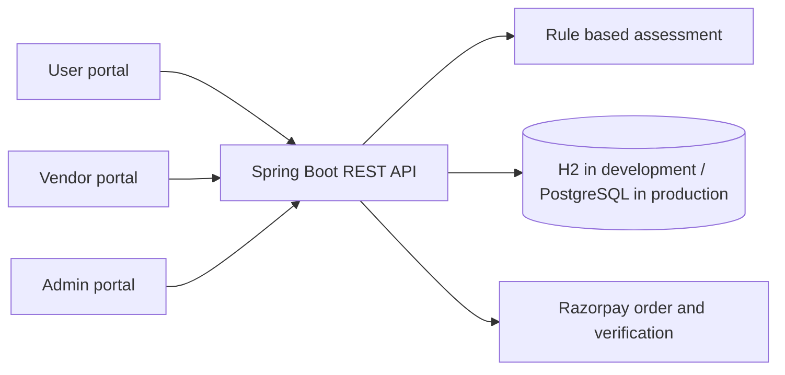
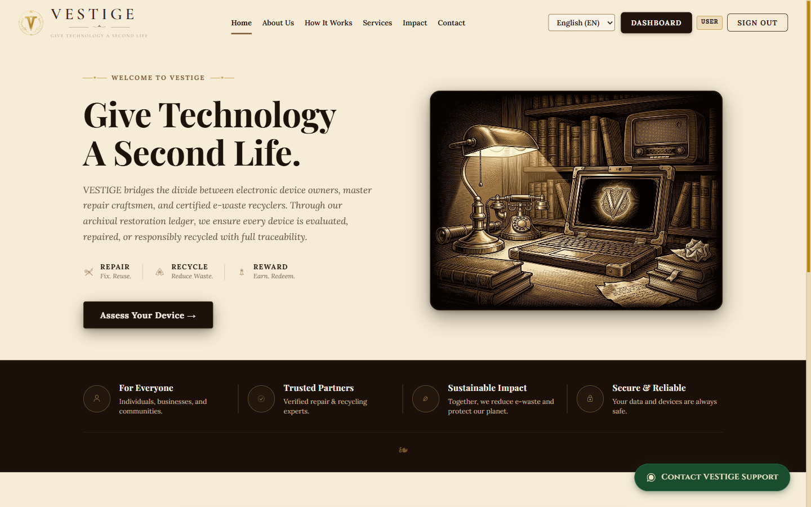

# VESTIGE — Give Technology a Second Life

VESTIGE is a web application that helps people decide whether to repair or recycle an electronic device, arrange the next step with a vendor, and track the result. It provides separate portals for device owners, vendors, and administrators.

**Submission materials:** [Detailed problem statement](PROBLEM_STATEMENT.md) · [14-slide presentation](docs/submission/VESTIGE_Evaluation_Presentation.pptx) · [GitHub repository](https://github.com/Jaswanth300/vestige)

**Project support:** WhatsApp or call **+91 81256 43574**. The footer and floating support control use this number.

> **Project status:** Local development and demonstration flows have been exercised. Production deployment, a live payment transaction, and real world environmental outcomes have not been verified. See [Current limitations](#current-limitations-and-next-steps).

## Contents

1. [Problem and objective](#problem-and-objective)
2. [What the application does](#what-the-application-does)
3. [How the system works](#how-the-system-works)
4. [Technology and project structure](#technology-and-project-structure)
5. [Run locally](#run-locally)
6. [Configuration](#configuration)
7. [API and data](#api-and-data)
8. [Verification](#verification)
9. [Current limitations and next steps](#current-limitations-and-next-steps)
10. [Evaluation submission](#evaluation-submission)
11. [Screenshots and visual design](#screenshots-and-visual-design)
12. [Operational details and troubleshooting](#operational-details-and-troubleshooting)

## Problem and objective

An owner of an old or damaged electronic device often has to make several separate decisions: whether repair is worthwhile, where to take the device, whether a recycler can accept it, and how to follow up. Vendors need a place to manage incoming jobs, while administrators need visibility into registrations and transactions. When these steps are disconnected, usable devices can be discarded and the eventual disposition is hard to track.

VESTIGE brings device assessment, repair and recycling requests, vendor status updates, and rewards into one workflow. Its decision engine produces an **explainable heuristic recommendation**, not an AI diagnosis or a certified environmental assessment. The full motivation, scope, stakeholders, and success criteria are in [PROBLEM_STATEMENT.md](PROBLEM_STATEMENT.md).

## What the application does

| Role | Available workflow |
| --- | --- |
| Device owner | Register or sign in; assess and submit a device; request repair or recycling; view bookings, rewards, and personal analytics. |
| Vendor | Sign in; view assigned repair and recycling work; update job status; view vendor analytics. |
| Administrator | Review users and vendors; inspect repair, recycling, reward, and payment records; view analytics, performance, and audit actions. |

Typical journey:

1. A user enters a device category, age, condition, estimated repair cost, value, parts availability, and known faults.
2. The backend calculates a restorability score from 5 to 95 and recommends **repair** for scores of 50 or above, otherwise **recycle**. The response includes a rationale and confidence band.
3. The user submits the device and creates a repair or recycling request with a vendor.
4. The vendor advances the request status; the owner can see the updated record.
5. Applicable completed activity can earn points, which the user can view and redeem from the catalog.
6. Administrators can monitor the corresponding records and aggregated activity.

The recommendation is based on fixed rules for repair cost relative to device value, category specific age, physical condition, parts availability, and known faults. Carbon and e-waste figures shown by the application are **category based estimates**, not measured savings. See [the implementation](backend/src/main/java/com/vestige/engine/DecisionEngineService.java) and [methodology notes](docs/intelligence/INTELLIGENCE_SPECIFICATION.md).

## How the system works



The frontend is a React single page application. It sends JSON requests to a Java Spring Boot API. The API handles authentication, role and ownership checks, assessment, bookings, rewards, payments, and analytics. The `dev` profile uses an in-memory H2 database with sample accounts; the `prod` profile is configured for PostgreSQL, with schema migrations in `supabase/migrations`.

### What an assessment contains

The form captures the device category, manufacturer, model, age, physical condition, parts availability, estimated repair cost, original value, and known issues. The backend compares repair cost with device value and applies category specific age thresholds, condition and parts deductions, and fault penalties. It clamps the resulting score to 5–95 and returns a recommendation, confidence band, and explanation. The same details can be saved with a device submission for follow up. This logic is deterministic and auditable; it does not learn from past jobs.

### Booking and reward lifecycle

Repair and recycling bookings are stored separately and linked to the submitting user and selected vendor. A vendor can update work assigned to that vendor; a user can view their own requests; administrators can review all requests. Reward accounts record earned and redeemed points as transactions so the balance can be explained. The seeded local database is for demonstration; its records reset when the backend process exits.

## Technology and project structure

| Layer | Technology |
| --- | --- |
| Frontend | React 19, React Router 7, Vite 8, CSS |
| Backend | Java 21, Spring Boot 3.4.3, Spring Security, Spring Data JPA |
| Data | H2 for local development; PostgreSQL/Supabase schema for production |
| Payments | Razorpay order creation and signature verification; credentials required |
| Tests | JUnit, Spring test stack, Oxlint, Vite production build |

### UI and motion

The interface uses a vintage archival visual system: parchment backgrounds, dark brown headings, gold accents, ornamental borders, and a matching hero illustration. Public pages, forms, dashboards, and the three portals use responsive layouts. Motion is used in loading states and CSS interactions; the evaluation deck uses fade transitions. The deck also includes screenshots captured from the locally running application, so its product examples show the actual UI rather than fabricated mockups.

```text
.
├── frontend/                 React app, routes, pages, API services
├── backend/                  Spring Boot API, services, entities, tests
├── supabase/migrations/      Versioned PostgreSQL schema and access grants
├── docs/architecture/        Architecture notes
├── docs/api/                 API specification
├── docs/intelligence/        Assessment methodology notes
├── docs/operations/          Deployment and operations guides
├── docs/submission/          Evaluation presentation and checklist
└── PROBLEM_STATEMENT.md      Detailed evaluation problem statement
```

## Run locally

### Requirements

- Node.js 20 or later and npm
- JDK 21
- Git

The project includes a Maven wrapper, so a separate Maven installation is not required. Use two terminals from the repository root.

**Terminal 1 — backend (PowerShell):**

```powershell
cd backend
.\mvnw.cmd spring-boot:run
```

**Terminal 1 — backend (macOS/Linux):**

```bash
cd backend
./mvnw spring-boot:run
```

The default `dev` profile listens at `http://localhost:8088`. Check `http://localhost:8088/api/health` and `http://localhost:8088/api/health/readiness`.

**Terminal 2 — frontend:**

```bash
cd frontend
npm install
npm run dev
```

Open `http://localhost:5173`. The frontend example configuration points its API client to `http://localhost:8088/api`.

### Demonstration accounts

The development profile seeds these accounts on backend startup. They are **sample credentials for local use only**; H2 data disappears when the process stops.

| Role | Email | Password |
| --- | --- | --- |
| User | `user@vestige.internal` | `User@123` |
| Vendor | `aegis@vestige.internal` | `Vendor@123` |
| Admin | `admin@vestige.internal` | `Admin@123` |

For a demo, sign in as the user, assess a device, submit it, and create a booking. Sign in as the vendor to advance its status, then return to the user account to view rewards and use the admin account to inspect records.

## Configuration

The example files are [`backend/.env.example`](backend/.env.example) and [`frontend/.env.example`](frontend/.env.example). **Spring Boot and Vite do not automatically load `backend/.env` as process environment variables**; set backend variables in your shell, IDE, or hosting provider. Vite reads `frontend/.env.local` or mode specific `.env` files.

| Variable | Purpose |
| --- | --- |
| `SPRING_PROFILES_ACTIVE` | `dev` for the seeded H2 demo; `prod` for PostgreSQL. |
| `PORT` | Backend port; development defaults to `8088`, production defaults to `8080`. |
| `DB_URL`, `DB_USERNAME`, `DB_PASSWORD` | PostgreSQL JDBC connection and application role credentials. |
| `JWT_SECRET` | Signing secret required outside the development setup. |
| `APP_BOOTSTRAP_ADMIN_EMAIL`, `APP_BOOTSTRAP_ADMIN_PASSWORD` | Optional initial production administrator provisioning. |
| `CORS_ALLOWED_ORIGINS` | Comma separated frontend origins allowed by the API. |
| `RAZORPAY_KEY_ID`, `RAZORPAY_KEY_SECRET` | Required for actual Razorpay checkout and server verification. |
| `VITE_API_BASE_URL` | Browser visible API URL, including `/api`. |

Keep secrets out of the frontend and Git. Apply `supabase/migrations` in order before starting against a new production database. See [deployment guidance](docs/operations/DEPLOYMENT_GUIDE.md) and [operations runbook](docs/operations/OPERATIONAL_RUNBOOK.md). Check provider settings against the current code before deploying; the guides are reference material, not proof of a live deployment.

### Production configuration sequence

1. Provision PostgreSQL and apply the SQL files in `supabase/migrations` in filename order.
2. Create the application database role and set `DB_URL`, `DB_USERNAME`, and `DB_PASSWORD` in the backend host.
3. Set `SPRING_PROFILES_ACTIVE=prod`, a strong `JWT_SECRET`, and the allowed frontend origin.
4. Set the initial admin email and password if the first production admin has not yet been created.
5. Configure the frontend's `VITE_API_BASE_URL` to the deployed API endpoint and rebuild the frontend.
6. Add Razorpay credentials only when a payment gateway environment is ready for an end to end checkout test.
7. Check the liveness and readiness endpoints, then exercise login and the three role workflows.

`backend/.env.example` is a template only. A `.env` file is not automatically imported into the Spring Boot process. Put values in the host environment or explicitly load them through your launch configuration.

## API and data

The base URL is `/api`. Main route groups:

| Route group | Purpose |
| --- | --- |
| `/auth` | Registration, login, current user, admin provisioning. |
| `/devices` | Assessment, submission, device lookup. |
| `/repairs`, `/recycling` | Booking creation, lookup, status updates. |
| `/vendors`, `/users` | Vendor listing and user settings. |
| `/rewards` | Balance, transactions, catalog, redemption. |
| `/payments` | Order creation, checkout verification, user history. |
| `/analytics`, `/admin` | Role specific analytics and administration. |
| `/health`, `/health/readiness` | Liveness and database readiness. |

### Frontend route map

| Audience | Routes |
| --- | --- |
| Public | `/`, `/portals`, `/login/user`, `/login/vendor`, `/login/admin`, `/register/user`, `/register/vendor` |
| User | `/user/dashboard`, `/user/assessment`, `/user/recycling`, `/user/rewards`, `/user/bookings`, `/user/analytics` |
| Vendor | `/vendor/dashboard`, `/vendor/analytics` |
| Admin | `/admin/dashboard`, `/admin/users`, `/admin/vendors`, `/admin/repairs`, `/admin/recycling`, `/admin/rewards`, `/admin/payments`, `/admin/analytics`, `/admin/performance`, `/admin/audit` |

The frontend uses `ProtectedRoute` for role aware navigation. Backend authorization is the source of truth for API access; hiding a page alone does not secure its data.

Endpoints, request shapes, and status codes are documented in [docs/api/API_SPECIFICATION.md](docs/api/API_SPECIFICATION.md) and implemented in [backend controllers](backend/src/main/java/com/vestige/controller). Core persisted records include users, vendors, device submissions, repair bookings, recycling bookings, reward accounts and transactions, payments, and audit actions. Protected API operations use signed JWTs and role or record ownership checks.

## Verification

Run the checks from the corresponding directories:

```powershell
# backend
cd backend
.\mvnw.cmd test

# frontend (in another terminal)
cd frontend
npm run lint
npm run build
```

At the last local check on **8 October 2026**, 57 backend tests passed, the frontend build passed, and lint exited successfully with nonblocking warnings. A local browser run covered login, assessment, repair and recycling bookings, vendor completion, rewards, redemption, and admin views. These checks do not establish production readiness or a successful live payment.

## Current limitations and next steps

- **Live payments:** Razorpay keys were unavailable for the local check. Checkout correctly reports a configuration error without them; a real order and callback still need sandbox or production credential testing.
- **Production database/deployment:** The PostgreSQL migrations and production environment need to be applied and verified on the target services. The present verification used the H2 development profile.
- **Password recovery:** A self service reset flow is not implemented. Login pages state this explicitly.
- **Environmental estimates:** Values are fixed category benchmarks in code. They should be calibrated against traceable data before being used as verified impact measurements.
- **Vendor qualification and operations:** Real vendor certification, pickup logistics, and downstream recycling evidence require an operational process outside the current software demo.
- **Documentation drift:** Some older design and deployment documents describe planned integrations. Use this README and the running routes as the implementation reference.

## Evaluation submission

| Form item | Prepared artifact |
| --- | --- |
| Problem statement | [PROBLEM_STATEMENT.md](PROBLEM_STATEMENT.md), with a short text suitable for a form field at the top. |
| PPT | [VESTIGE_Evaluation_Presentation.pptx](docs/submission/VESTIGE_Evaluation_Presentation.pptx). |
| GitHub repository link | [https://github.com/Jaswanth300/vestige](https://github.com/Jaswanth300/vestige). |

The submission repository is owned by [Jaswanth300](https://github.com/Jaswanth300). The [submission checklist](docs/submission/SUBMISSION_CHECKLIST.md) lists the final review steps.

## Screenshots and visual design

These screenshots were captured from the locally running web application on 8 October 2026. They are included in the [evaluation PPT](docs/submission/VESTIGE_Evaluation_Presentation.pptx).

| View | Screenshot |
| --- | --- |
| Landing page | [Open screenshot](docs/submission/screenshots/landing.png) |
| User dashboard | [Open screenshot](docs/submission/screenshots/user_dashboard.png) |
| Device assessment | [Open screenshot](docs/submission/screenshots/assessment.png) |
| Vendor dashboard | [Open screenshot](docs/submission/screenshots/vendor_dashboard.png) |
| Admin dashboard | [Open screenshot](docs/submission/screenshots/admin_dashboard.png) |



## Operational details and troubleshooting

| Symptom | Check |
| --- | --- |
| Browser cannot reach the API | Confirm the backend is running on port 8088 locally and `VITE_API_BASE_URL` ends with `/api`. |
| Login fails after restart | The H2 development database resets on restart; use the seeded development accounts again. |
| A protected page redirects to login | Sign in with the correct role and check that the backend is reachable. |
| Readiness endpoint is not ready | Check database connectivity and whether the schema exists for the selected profile. |
| Payment checkout shows a configuration error | Set valid Razorpay gateway credentials on the backend and test in the appropriate gateway environment. |
| Vite chooses port 5174 | Another process is using 5173; close that process or open the URL Vite prints. Update CORS if using a different origin. |

For source level detail, review [architecture](docs/architecture/ARCHITECTURE.md), [API contracts](docs/api/API_SPECIFICATION.md), [decision engine notes](docs/intelligence/INTELLIGENCE_SPECIFICATION.md), and the [operations runbook](docs/operations/OPERATIONAL_RUNBOOK.md). Some older documents contain proposed features and should be cross checked against the current code.
